<picture><source media="(prefers-color-scheme: dark)" srcset="assets/hero-dark.svg"></picture>

<picture><source media="(prefers-color-scheme: dark)" srcset="assets/social-l-dark.svg"></picture><a href="https://t.me/rwxmemory"><picture><source media="(prefers-color-scheme: dark)" srcset="assets/social-1-dark.svg"></picture></a><a href="https://ko-fi.com/cutemabel"><picture><source media="(prefers-color-scheme: dark)" srcset="assets/social-2-dark.svg"></picture></a><a href="https://music.youtube.com/@LainForYou"><picture><source media="(prefers-color-scheme: dark)" srcset="assets/social-3-dark.svg"></picture></a><picture><source media="(prefers-color-scheme: dark)" srcset="assets/social-r-dark.svg"></picture>

<a href="https://github.com/glassprincess/tty3d"><picture><source media="(prefers-color-scheme: dark)" srcset="assets/project-tty3d-dark.svg"></picture></a>&nbsp;<a href="https://github.com/glassprincess/FisherExtension"><picture><source media="(prefers-color-scheme: dark)" srcset="assets/project-fisherextension-dark.svg"></picture></a>

<picture><source media="(prefers-color-scheme: dark)" srcset="assets/stack-dark.svg"></picture>

<picture><source media="(prefers-color-scheme: dark)" srcset="assets/wave-dark.svg"></picture>

<a href="https://github.com/glassprincess?tab=repositories"><picture><source media="(prefers-color-scheme: dark)" srcset="assets/button-1-dark.svg"></picture></a>

<a href="https://metawka.github.io/expressive-profile/?from=glassprincess"><picture><source media="(prefers-color-scheme: dark)" srcset="assets/credit-dark.svg"></picture></a>

